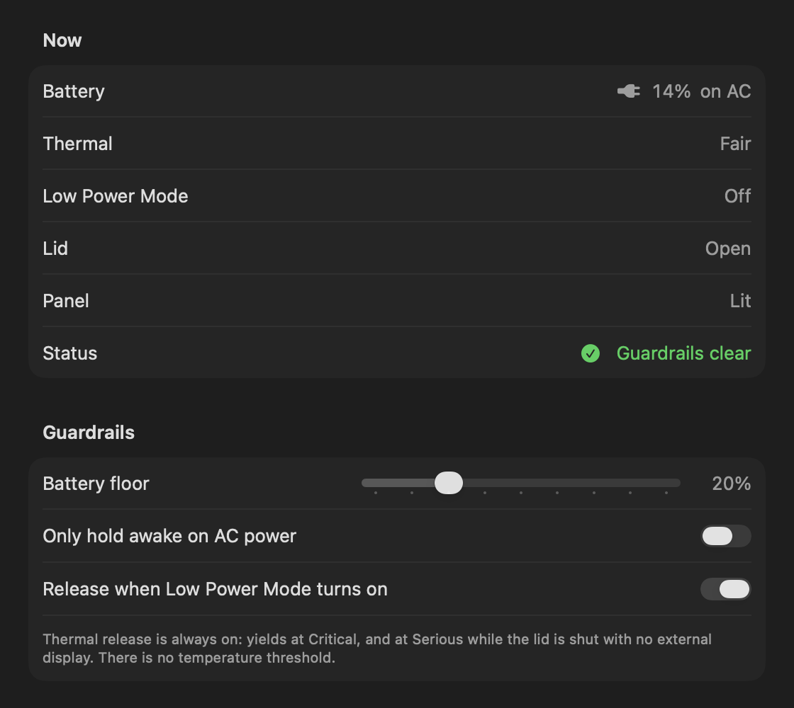
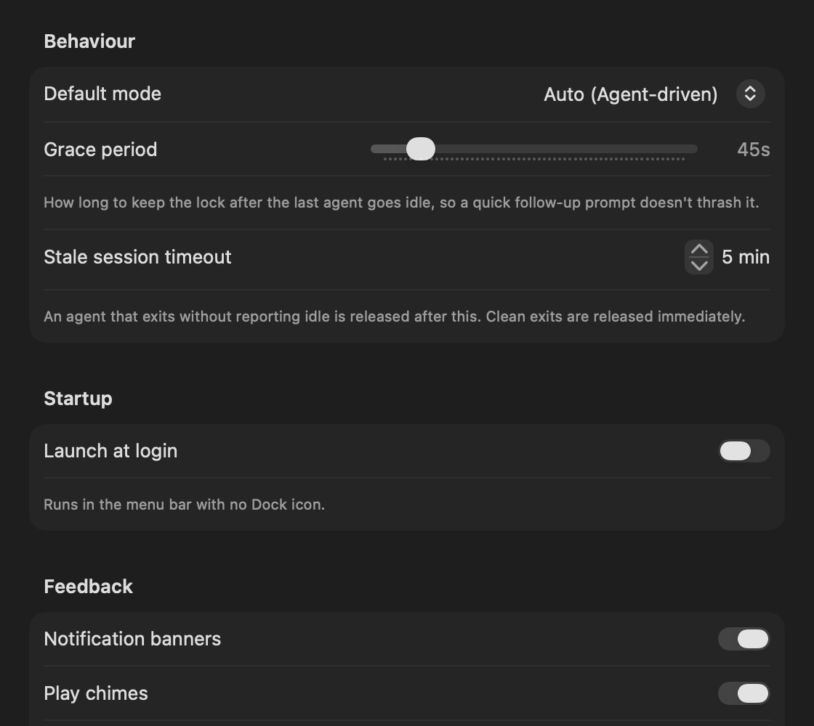
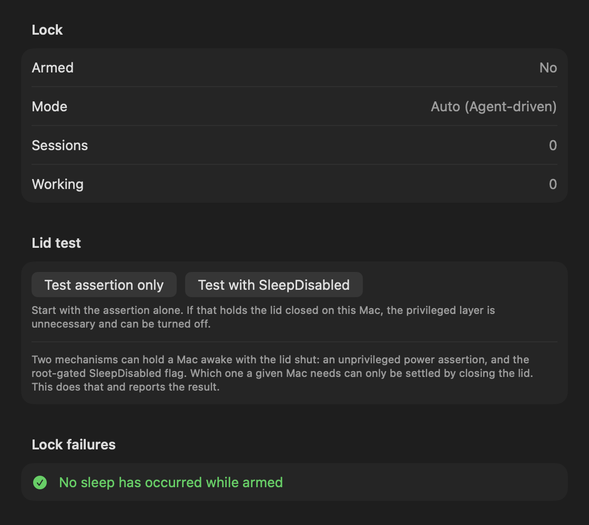

<div align="center">

<picture>
  <source media="(prefers-color-scheme: dark)" srcset="assets/wordmark.png">
  
</picture>

### Keep your Mac awake while your AI coding agent works.

Coding agents can run for minutes or hours on their own. Lucid keeps your Mac awake while
the agent is actually working, and lets it sleep again the moment the agent is only
waiting for you.

<br>

**[Download Lucid&nbsp;→](https://manasvinyadav.gumroad.com/l/kasww)**

[Releases](https://github.com/ManasvinYadav/Lucid/releases/latest) &nbsp;·&nbsp;
[Source](#build-from-source) &nbsp;·&nbsp;
[Report a bug](https://github.com/ManasvinYadav/Lucid/issues)

<br>


<sub>macOS 14 or later &nbsp;·&nbsp; Apple Silicon &nbsp;·&nbsp; Signed and notarised &nbsp;·&nbsp; MIT-licensed source</sub>

</div>

<br>

## Why Lucid

An agent left on a long task can lose its Mac to sleep halfway through. The usual fix is to
keep the Mac awake all the time, which means it never sleeps.

Other keep-awake tools have to guess. A running process, an open terminal or a CPU spike
can't tell you whether an agent is generating or sitting at a prompt for twenty minutes.

Lucid doesn't guess. Coding agents report their own lifecycle through hooks: `working` when
a turn starts or a tool runs, `idle` when they go back to waiting for you. Lucid listens to
those events and holds the Mac awake for exactly that long.

## Features

- **Awake only while work happens.** Held while any agent session is working, released
  when the last one goes idle, after a short grace period (45 s by default).
- **Keeps working with the lid shut.** Optional, using a one-time, narrowly scoped
  privilege rule. Without it, Lucid still prevents idle sleep with the lid open.
- **Sleeps when it's done.** If the work finishes with the lid shut and no external
  display, Lucid puts the Mac to sleep rather than leaving it running in your bag.
- **Hooks for 11 agents.** Claude Code, Codex CLI and Gemini CLI are verified against
  real installs. Cursor, Copilot CLI, Factory Droid, Qwen Code, Cline, Devin, opencode and
  Amp are built from each tool's documentation. Anything else can report through a
  wrapper script or a one-line socket protocol.
- **Process fallback.** Tools with no hooks can be tracked by process activity, clearly
  badged as inferred rather than reported.
- **Guardrails.** Releases on a battery floor, off AC power (if you choose), when Low Power
  Mode turns on, under thermal pressure, or after a time limit with the lid shut.
- **Native menu bar app.** Live sessions, Off / Auto / Always modes, Pause for 30 min or 1 h,
  and a global shortcut (⌃⌥⌘L).
- **History and diagnostics.** Per-session history, a "while you were away" report when you
  open the lid, a lid test you run by really closing the lid, and a `--selftest` command.
- **Guided setup and a clean uninstall.** First-run setup previews every change before
  making it, and Remove Everything takes it all out again.

## How it works

```
  Agent starts a turn or runs a tool
                 ↓
  Hook sends "working" to Lucid
                 ↓
  Lucid holds a power assertion — the Mac stays awake
                 ↓
  Agent finishes, or stops to wait for you
                 ↓
  Hook sends "idle"; the grace period runs out
                 ↓
  Lucid releases everything — the Mac sleeps normally
```

Lucid is built not to hold a Mac awake by accident:

- Sessions that go silent are dropped after a timeout (5 min by default), so a crashed agent
  can't keep the Mac awake forever.
- When an agent reports its process, Lucid notices the moment that process exits.
- The display is never held awake. The screen still dims and turns off as usual.
- If Lucid itself crashes while holding the lid-shut flag, it clears it on the next launch.

<details>
<summary><b>Why lid-shut support needs a privilege rule</b></summary>

<br>

macOS treats closing the lid as a *demand* sleep and never consults power assertions.
`kIOPMAssertionTypePreventSystemSleep` has been a documented no-op since 10.9: it returns
success and does nothing. The only thing that vetoes clamshell sleep is the `SleepDisabled`
system flag, which only root can set.

So Lucid can install a sudoers rule scoped to exactly two commands:

```
<user> ALL=(root) NOPASSWD: /usr/bin/pmset -a disablesleep 1, /usr/bin/pmset -a disablesleep 0
```

It's one password prompt, from **Settings → Privileges**, and nothing else is granted. It is
deliberately not `pmset *`, which would be a general root escalation. Skip it and Lucid
still prevents idle sleep with the lid open.

The **lid test** under Diagnostics has you close the lid for real, then reports which layer
your Mac needs.

</details>

## Screenshots

<div align="center">

</div>

<br>

| Power | General | Diagnostics |
|---|---|---|
|  |  |  |

## Get Lucid

The easiest way to install Lucid is through the official release.

**[Download Lucid&nbsp;→](https://manasvinyadav.gumroad.com/l/kasww)**

1. Download Lucid and open the DMG.
2. Drag **Lucid** to **Applications**.
3. Launch Lucid. It lives in the menu bar, with no Dock icon.
4. Follow the setup window: lid-shut support, agent hooks and launch at login. Each step
   is optional and also lives in Settings.

The release is signed with a Developer ID and notarised by Apple, so it opens without a
Gatekeeper warning.

The signed, notarised DMG is available only from Gumroad. To use Lucid for free,
[build it from source](#build-from-source).

## Requirements

- **macOS 14 Sonoma** or later
- **Apple Silicon.** Release builds are arm64 only, and Intel Macs are not supported.
- **Agent hooks** are installed by a script that uses `python3` from Apple's Command Line
  Tools (`xcode-select --install`). Lucid tells you if it's missing.

## Privacy and security

**Stays on your Mac.** Lucid contains no networking code: no analytics, no telemetry, no
update checks and no account. Its settings, live state (`~/.lucid/status.json`) and session
history (`~/.lucid/history.json`) are local files.

**The socket.** Agents talk to Lucid over a Unix domain socket at `~/.lucid/agent.sock`,
mode 0600 inside a 0700 directory, so only your user can reach it. It is deliberately not a
loopback TCP port, which any process or web page could reach. Each message is one line of
JSON: an agent name, a session id, a status, an optional detail and a pid.

**Power.** Lucid holds a standard, unprivileged `PreventUserIdleSystemSleep` assertion while
an agent works. Lid-shut support is optional and uses the two-command sudoers rule described
above. The rule lives at `/etc/sudoers.d/lucid`, and you can remove it from Settings at any
time.

**What it touches:**

- **Agent hooks.** Lucid adds its entries to each agent's own config file. You preview the
  change first, the original is backed up, and Remove takes Lucid's entries out again.
- **Notifications.** macOS asks for permission once. Chimes work without it.
- **Documents.** macOS asks once for access to `~/Documents`, only if you use Cline,
  whose hooks live there.
- **Launch at login.** Off unless you turn it on, using a LaunchAgent in
  `~/Library/LaunchAgents`.
- **Processes.** The optional process fallback reads process names and CPU time to spot
  tools that have no hooks.

## Open source

Lucid's source code is **MIT-licensed** and lives in this repository. You can read it,
build it and modify it.

| | |
|---|---|
| **Source code** | MIT-licensed, in this repository. Free to build and use. |
| **Signed, notarised release** | A paid download on [Gumroad](https://manasvinyadav.gumroad.com/l/kasww). It's a build of this same source, signed with a Developer ID and notarised by Apple, ready to install. Buying it supports the project. |
| **GitHub Releases** | Release notes and source archives only, with no prebuilt app. |

The Gumroad build has no features the source lacks.

Third-party assets keep their own licences. The wordmark font is Borel (SIL Open Font
License 1.1) and the demo film's music is CC BY 4.0. See [Credits](#credits).

## FAQ

**Does Lucid work with Claude Code?**

Yes, and it's one of the three integrations verified against a real install. Install its
hooks from **Settings → Agents**.

**Does Lucid keep my Mac awake all the time?**

No. In Auto mode it holds the Mac awake only while an agent session is working. Always
Awake mode exists if you want it, and Off turns it off.

**What happens when the agent becomes idle?**

When the last working session goes idle, a grace period starts (45 s by default,
adjustable from 10 s to 5 min) so a quick follow-up prompt doesn't toggle the lock. When it
runs out, Lucid releases everything. If the lid is shut and no external display is
attached, Lucid then puts the Mac to sleep.

**Does Lucid prevent manual sleep?**

The power assertion only blocks *idle* sleep, so choosing Sleep still works. With lid-shut
support on, Lucid sets macOS's `SleepDisabled` flag while an agent is working, and that flag
prevents the system from sleeping until Lucid clears it.

**Is Lucid available for Apple Silicon?**

Yes, and only Apple Silicon. The release is arm64 and needs macOS 14 or later.

**Is the downloaded release notarised?**

Yes. It's signed with a Developer ID, built with the hardened runtime, notarised by Apple,
and the ticket is stapled to the app and the DMG.

**Can I build Lucid from source?**

Yes, for free. See [Build from source](#build-from-source). The signed, notarised build is
the paid download on Gumroad.

## Support

For bugs and technical issues, **[report an issue](https://github.com/ManasvinYadav/Lucid/issues)**.
Please include your macOS version, the agent and its version, and what the menu showed.

For questions and feedback, an issue is the right place too.

You can also support Lucid through [GitHub Sponsors](https://github.com/sponsors/ManasvinYadav).

<br>

---

<br>

## Agent hooks

Install them from **Settings → Agents**, or from a terminal with the copy inside the app
(in a source checkout it's `./hooks/install-hooks.sh`):

```bash
H=/Applications/Lucid.app/Contents/Resources/hooks/install-hooks.sh
"$H" --list               # supported, detected, installed
"$H" codex                # preview as a diff, changes no agent config
"$H" codex --apply        # merge in (changed files are backed up first)
"$H" codex --uninstall    # take Lucid's entries out again
```

The agent defaults to `claude-code`. The installer merges into the hooks you already have,
never replaces them, and running it twice changes nothing. It refuses to touch a file it
can't parse, including JSON with comments, rather than guess.

| Agent | How | Written to | |
|---|---|---|---|
| Claude Code | hooks | `~/.claude/settings.json` | verified |
| Codex CLI | hooks | `~/.codex/hooks.json` | verified |
| Gemini CLI | hooks | `~/.gemini/settings.json` | verified |
| Cursor | hooks | `~/.cursor/hooks.json` | best-effort |
| Copilot CLI | hooks | `~/.copilot/hooks/lucid.json` (its own file) | best-effort |
| Factory Droid | hooks | `~/.factory/hooks.json` | best-effort |
| Qwen Code | hooks | `~/.qwen/settings.json` | best-effort |
| Cline | hook scripts | `~/Documents/Cline/Hooks/` (one file per hook) | best-effort |
| Devin | hooks | `~/.config/devin/config.json` | best-effort |
| opencode | plugin | `~/.config/opencode/plugins/lucid.js` | best-effort |
| Amp | plugin | `~/.config/amp/plugins/lucid.ts` | best-effort |
| Aider | wrapper script | — | no hooks |
| Windsurf | process activity | — | see below |

**Verified** means the event names and file format were checked against a real install
(Claude Code 2.1, Codex 0.150, Gemini CLI 0.56). **Best-effort** means built from the tool's
documentation but not yet run against it. If one misbehaves, please open an issue with the
tool's version.

<details>
<summary><b>Per-agent notes</b></summary>

<br>

- **Codex** skips new hooks until you trust them. Run `/hooks` in Codex once after installing.
- **Gemini CLI** runs hooks only in trusted folders, and only in sessions started afterwards.
- **Cursor** has no hook for "waiting for approval", so a Cursor chat reads as working
  while an approval prompt is open. Cursor also runs Claude Code's hooks, and Lucid reports
  those as Cursor so they don't show up as a phantom Claude Code session.
- **Qwen Code** reads hooks when a session starts, so restart any open session.
- **Cline** (the VS Code extension and the CLI) keeps hooks in `~/Documents`, so macOS
  asks once for Documents access. Lucid only looks there once it finds Cline itself. Like
  Cursor, Cline has no hook for waiting on approval, and it has no session-end hook either:
  a finished task leaves the list when the next one starts, or when Cline exits. Cline runs
  one script per hook, so Lucid won't install over a script of your own there; move it
  aside first.
- **Devin** covers Devin CLI and Devin Local in Devin Desktop. Devin can also run the
  Claude Code hooks in `~/.claude/settings.json`, and Lucid reports those as Devin.
- **Windsurf** gets no hooks from Lucid. Its Cascade agent had them, but with no event for
  a cancelled turn a session could stay "working" and keep the Mac awake, and Devin Desktop
  3.9.19 removed Cascade anyway. Use the Devin entry for Devin Local; Cascade falls back to
  process activity.
- **opencode** and **Amp** load plugins at startup, so restart them (or run Amp's
  `plugins: reload`).
- Lucid 0.10 wrote Codex hooks to `config.toml` and opencode hooks to `config.json`, and
  neither tool reads those. Settings → Agents marks them **Outdated**, and installing
  again removes them.

</details>

<details>
<summary><b>Claude Code event mapping</b></summary>

<br>

| Claude Code event | Sent | Why |
|---|---|---|
| `SessionStart` | `idle` | The session exists and is waiting for a prompt |
| `UserPromptSubmit` | `working` | The turn begins |
| `PreToolUse` / `PostToolUse` / `PostToolUseFailure` | `working` | Doubles as a heartbeat for long tool runs |
| `SubagentStart` / `SubagentStop` | `working` | Background agents count as work |
| `Notification` | `idle` | Only permission, idle and elicitation prompts: Claude Code is waiting for you |
| `Stop` / `StopFailure` | `idle` | The turn completed, or ended on an API error |
| `SessionEnd` | `ended` | Reap the session |

The other agents map their own events the same way. `install-hooks.sh <agent>` shows the
exact entries before anything is written.

</details>

### Any other agent

Send one line of JSON to `~/.lucid/agent.sock`:

```json
{"agent":"my-agent","session_id":"abc","status":"working","detail":"Tool Running","pid":4242}
```

`status` is `working`, `idle` or `ended`. `pid` is the agent's process. While it runs, a
session that has gone quiet is kept. Without it, a `working` session with no event for the
timeout (5 min) is dropped, even mid-task. The bundled client sends the pid for you:

```sh
~/.lucid/lucid-notify [--stdin] <agent> <working|idle|ended> [detail]
```

With `--stdin` it reads the hook's JSON payload for the agent's own session id. It waits at
most a second for the payload and a second for the app, never fails the calling agent, and
always exits 0.

**A CLI with no hooks:** wrap it. This reports `working` for as long as the process runs, so
it can't tell working from waiting at a prompt:

```sh
#!/bin/sh
export LUCID_SESSION_ID="wrap-$$" LUCID_PID=$$
"$HOME/.lucid/lucid-notify" my-agent working "Running"
real-agent-binary "$@"
rc=$?
"$HOME/.lucid/lucid-notify" my-agent ended
exit $rc
```

**GUI tools with no hooks** (Windsurf, or Cursor and the Cline CLI before their hooks are
installed) fall back to process activity, badged `Process` in the menu so an inferred state
is never mistaken for a reported one. Once an agent's hooks are installed, Lucid stops
guessing from its processes. The Cline VS Code extension runs inside VS Code's own helper
process, so only its hooks can report it. The list lives in Settings → Agents: an entry
matches a process name or, if it contains a `/`, a fragment of the full path.

## Guardrails

Battery, AC, Low Power Mode and thermal changes arrive as system events. The lid is read
every 5 s, and the lid-shut time limit is checked every 30 s. All of these use public,
entitlement-free APIs.

- **Battery floor** (10–50%). Releases below the threshold unless the battery is actually
  charging: on battery, or on a charger too weak to keep up.
- **AC only.** Only hold the Mac awake while it's plugged in.
- **Low Power Mode.** Yields as soon as it turns on.
- **Thermal.** Yields at `.critical`, and at `.serious` while the lid is shut with no
  external display.
- **Lid-shut time limit.** On by default at 2 hours (Settings → Power → Time limit, 15 min
  to 8 h, or off). This is how long the lock may hold with the lid shut and no external
  display, after which it's released and the Mac goes to sleep. The clock starts when the
  lid shuts, or when the last display is unplugged with the lid shut.

There's deliberately **no °C threshold**. Apple Silicon runs at 70–100 °C by design and
throttles itself in hardware, and die temperature doesn't track the thermal pressure macOS
reports.

## Crash safety

`SleepDisabled` persists across reboot, so a crash while it's set could leave the Mac unable
to sleep. Three teardown paths cover it:

- `atexit` for normal termination
- `DispatchSource` signal handlers for `SIGTERM`, `SIGINT` and `SIGHUP`
- An **arm-marker file** (`~/.lucid/armed`) for `kill -9`. If it survives to the next launch,
  Lucid clears `SleepDisabled` and says so.

<details>
<summary><b>How Lucid compares</b></summary>

<br>

Checked against each product's own documentation, not assumed.

| | Caffeine | Amphetamine | Lucid |
|---|:---:|:---:|:---:|
| Prevents idle sleep | yes | yes | yes |
| Survives a lid close | no | yes | yes |
| …without an external display, keyboard or charger | — | yes | yes |
| Starts and stops on its own | no | yes | yes |
| What decides that | nothing, you click it | app running, CPU %, network, drive, audio, battery, idle timer | the agent's own lifecycle events |
| Tells *generating* apart from *waiting at a prompt* | no | no | **yes** |
| Battery floor / AC-only / Low Power Mode / thermal release | no | battery trigger | all four |
| Per-session history and an away report | no | no | yes |
| Source available | no | no | yes, MIT |

Amphetamine is a genuinely good app with a much broader list of triggers, and its
closed-display mode needs no charger or second display either. What it can't do, because
no trigger exposes it, is tell an agent that's generating from one that's waiting for you.

GPU utilisation can't settle it either. `Device Utilization %` commonly sits at 20–40% on
an idle desktop, dominated by WindowServer, and even per-process GPU accounting can't tell
"generating" from "waiting at a prompt". Only a lifecycle hook can.

</details>

## Build from source

You need macOS 14 or later on Apple Silicon and the Swift toolchain from Xcode or the
Command Line Tools. There are no dependencies, no Xcode project and no Swift Package
Manager: `build.sh` makes one `swiftc` call and assembles the bundle.

```bash
git clone https://github.com/ManasvinYadav/Lucid.git
cd Lucid
./build.sh
open build/Lucid.app
```

A local build is ad-hoc signed, which is fine on the Mac that built it. The app icon is
generated from code by `tools/wordmark.swift`, so there's no asset catalog.

The Gumroad release is additionally signed with a Developer ID and the hardened runtime,
then notarised and stapled. A local build works the same without any of that.

### Test and debug

```bash
build/Lucid.app/Contents/MacOS/Lucid --selftest        # checks every signal Lucid reads
build/Lucid.app/Contents/MacOS/Lucid --login-item on   # or off
cat ~/.lucid/status.json                               # live state, rewritten on change
pmset -g assertions | grep Lucid                       # what macOS thinks Lucid holds
pmset -g | grep SleepDisabled                          # the lid-shut flag
```

To inspect the UI without Screen Recording permission:

```bash
swiftc -O -target arm64-apple-macos14.0 -D DEBUG_RENDER \
  -framework SwiftUI -framework AppKit -framework IOKit \
  -framework Carbon -framework UserNotifications \
  -o /tmp/LucidRender Sources/*.swift
/tmp/LucidRender --render-settings /tmp/ui
```

This dumps each settings pane and the menu to PNG by capturing the real view hierarchy. It's
compiled out of normal builds.

## Credits

- The wordmark is set in [Borel](https://github.com/RosaWagner/Borel), copyright 2023 The
  Borel Project Authors, under the [SIL Open Font License 1.1](assets/fonts/OFL.txt). It's
  vendored in `assets/fonts/`.
- The film's music is *Convergence* by [Scott Buckley](https://www.scottbuckley.com.au),
  licensed [CC BY 4.0](https://creativecommons.org/licenses/by/4.0/). It's used in
  `media/Lucid-music.mp4`; `media/Lucid.mp4` is the silent cut.
- The film itself is generated from code. See `media/Film.swift`.

## License

The source code is [MIT](LICENSE).
